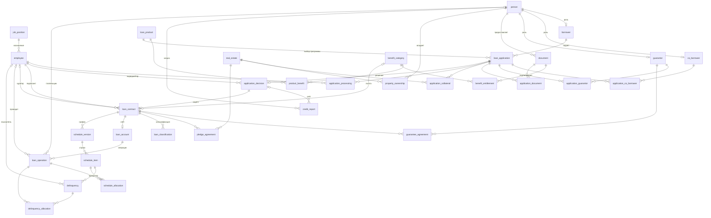

# База данных «Ипотечное кредитование физических лиц»

Учебный проект по курсу «Базы данных»: проектирование реляционной базы данных по полному циклу, от анализа предметной области до работающей схемы в PostgreSQL с демонстрационным сценарием и набором запросов.

База покрывает жизненный цикл ипотечного кредита. Клиент приходит в банк и подаёт заявку. Банк проверяет документы и кредитную историю, оценивает залог и выносит решение. Затем заключается договор, открывается ссудный счёт, строится график платежей и учитываются платежи. При просрочке начисляется неустойка и ведётся взыскание.

**Стек:** PostgreSQL, pgAdmin 4, draw.io

**В цифрах:** 20 классов данных, 7 бизнес-функций, 33 связи на ER-диаграмме, 32 таблицы, 48 внешних ключей, более 100 именованных ограничений CHECK и UNIQUE.

> Проект в работе: индексы, триггеры и полный набор тестовых данных будут добавлены позже (см. [План развития](#план-развития)).

---

## Содержание

1. [Предметная область](#предметная-область)
2. [Структура репозитория](#структура-репозитория)
3. [Как запустить](#как-запустить)
4. [Этап 1. Деловая модель](#этап-1-деловая-модель)
5. [Этап 2. ER-модель](#этап-2-er-модель)
6. [Этап 3. Реляционная схема](#этап-3-реляционная-схема)
7. [Этап 4. Физическая модель в PostgreSQL](#этап-4-физическая-модель-в-postgresql)
8. [Этап 5. Демонстрация и запросы](#этап-5-демонстрация-и-запросы)
9. [План развития](#план-развития)

---

## Предметная область

Банк выдаёт ипотечные кредиты **только физическим лицам**. В сделке участвуют три роли: заёмщик, созаёмщик и поручитель. Один человек может выступать в разных ролях в разных сделках: например, быть заёмщиком по своей ипотеке и поручителем по ипотеке брата.

Требования, которые определили структуру базы:

- **Условия программы меняются, история выданных кредитов нет.** Фактические сумма, срок и ставка фиксируются в решении и договоре, а не берутся из кредитного продукта.
- **График платежей пересчитывается, старый график сохраняется.** При досрочном погашении или реструктуризации создаётся новая версия графика.
- **Деньги распределяются гибко.** Один платёж может погасить несколько строк графика, а одна строка может гаситься несколькими платежами.
- **Данные не удаляются.** Запись, на которую ссылаются другие, удалить нельзя; договоры и операции меняют статус.

---

## Структура репозитория

```
.
├── README.md
├── docs/
│   ├── 01_business_model.xlsx      деловая модель: классы данных, функции, матрица
│   ├── 02_er_diagram.drawio        ER-диаграмма (исходник draw.io)
│   ├── 02_er_diagram.png           ER-диаграмма (картинка)
│   ├── 03_er_attributes.docx       блок атрибутов сущностей и связей
│   ├── 04_relational_schema.docx   реляционная схема: отношения и ключи
│   ├── 05_data_types.xlsx          выбор типов данных для атрибутов
│   └── 06_data_dictionary.pdf      словарь данных: таблицы и поля с переводом
└── sql/
    ├── 01_schema.sql                   создание схемы, таблиц и ограничений
    ├── 02_demo_person_to_contract.sql  сценарий «от клиента до договора»
    └── 03_queries.sql                  запросы: от SELECT до подзапросов и CTE
```

Документы в `docs/` пронумерованы в порядке этапов проектирования: каждый следующий построен на предыдущем.

---

## Как запустить

**Через Docker** (устанавливать PostgreSQL не нужно):

```bash
docker run --name credit-db -e POSTGRES_PASSWORD=postgres -p 5432:5432 -d postgres:16
psql -h localhost -U postgres -f sql/01_schema.sql
```

**Через pgAdmin:** открыть Query Tool, открыть `sql/01_schema.sql` и выполнить.

Скрипт начинается с `drop schema if exists credit_deal cascade`, поэтому его можно запускать повторно: схема каждый раз создаётся с нуля.

**Демонстрационный сценарий** `02_demo_person_to_contract.sql` начинается с `BEGIN` и не завершает транзакцию. После выполнения нужно выполнить `ROLLBACK`, чтобы отменить изменения, или `COMMIT`, чтобы их сохранить.

---

## Этап 1. Деловая модель

📄 [`docs/01_business_model.xlsx`](docs/01_business_model.xlsx)

### Зачем этот этап

Прежде чем рисовать таблицы, нужно понять, **какие данные** нужны бизнесу и **кто** их использует. Деловая модель отвечает на два вопроса:

1. О чём банк хранит информацию (классы данных).
2. Что банк делает (бизнес-функции) и какие данные нужны каждой функции.

Ответ оформляется матрицей «функции × классы данных». Она проверяет полноту: класс, который не нужен ни одной функции, лишний; функция, которой не хватает данных, говорит о пропущенном классе.

### Классы данных

| Код | Класс данных | Тип | Зависит от |
|---|---|---|---|
| Д1 | Физическое лицо | Суперкласс | |
| Д2 | Заёмщик | Подкласс | Физическое лицо |
| Д3 | Созаёмщик | Подкласс | Физическое лицо |
| Д4 | Поручитель | Подкласс | Физическое лицо |
| Д5 | Категория льготы | Сильная | |
| Д6 | Кредитный продукт | Сильная | |
| Д7 | Кредитная заявка | Слабая (E) | Кредитный продукт |
| Д8 | Документ | Слабая (E) | Физическое лицо |
| Д9 | Кредитная история | Слабая (E) | Физическое лицо |
| Д10 | Должность | Сильная | |
| Д11 | Сотрудник банка | Сильная | |
| Д12 | Объект недвижимости | Сильная | |
| Д13 | Решение по заявке | Слабая (E) | Кредитная заявка |
| Д14 | Кредитный договор | Сильная | |
| Д15 | Классификация ссуды | Слабая (ID) | Кредитный договор |
| Д16 | Ссудный счёт | Слабая (E) | Кредитный договор |
| Д17 | Версия графика платежей | Слабая (ID) | Кредитный договор |
| Д18 | Строка графика платежей | Слабая (ID) | Версия графика |
| Д19 | Операция по ссудному счёту | Слабая (E) | Ссудный счёт |
| Д20 | Просрочка и санкции | Слабая (E) | Строка графика |

### Бизнес-функции

| Код | Функция |
|---|---|
| Ф1 | Ведение каталога продуктов, льгот и персонала |
| Ф2 | Приём и регистрация заявок |
| Ф3 | Верификация, проверка кредитной истории и андеррайтинг |
| Ф4 | Оформление договора и залога |
| Ф5 | Открытие счёта и выдача кредита |
| Ф6 | Сопровождение и контроль платежей |
| Ф7 | Мониторинг и взыскание просрочки |

### Матрица «классы данных × функции»

`X` означает, что функция использует класс данных.

| Класс данных | Ф1 | Ф2 | Ф3 | Ф4 | Ф5 | Ф6 | Ф7 |
|---|:-:|:-:|:-:|:-:|:-:|:-:|:-:|
| Д1. Физическое лицо | | X | X | X | X | X | X |
| Д2. Заёмщик | | X | X | X | X | X | X |
| Д3. Созаёмщик | | X | X | X | | X | X |
| Д4. Поручитель | | X | X | X | | X | X |
| Д5. Категория льготы | X | X | X | X | | | |
| Д6. Кредитный продукт | X | X | X | X | | | |
| Д7. Кредитная заявка | | X | X | X | | | |
| Д8. Документ | | X | X | X | | | |
| Д9. Кредитная история | | | X | | | | X |
| Д10. Должность | X | | X | X | | | |
| Д11. Сотрудник банка | X | X | X | X | X | X | X |
| Д12. Объект недвижимости | | X | X | X | X | | X |
| Д13. Решение по заявке | | | X | X | | | |
| Д14. Кредитный договор | | | | X | X | X | X |
| Д15. Классификация ссуды | | | | | X | X | X |
| Д16. Ссудный счёт | | | | | X | X | X |
| Д17. Версия графика платежей | | | | X | X | X | |
| Д18. Строка графика платежей | | | | X | X | X | X |
| Д19. Операция по ссудному счёту | | | | | X | X | X |
| Д20. Просрочка и санкции | | | | | | X | X |

**Что видно из матрицы.** Данные движутся по жизненному циклу кредита. Справочники (Д5, Д6, Д10) нужны в начале. Заявка и решение (Д7, Д13) живут только до заключения договора. Счёт, график и операции (Д16–Д20) появляются после него. Сотрудник банка (Д11) участвует во всех функциях: значит, у него будет много связей в разных ролях.

---

## Этап 2. ER-модель

📄 [`docs/02_er_diagram.drawio`](docs/02_er_diagram.drawio) · [`docs/03_er_attributes.docx`](docs/03_er_attributes.docx)


Атрибуты сущностей и связей вынесены в отдельный «Блок атрибутов», чтобы диаграмма оставалась читаемой.

### Обозначения

| Элемент | Значение |
|---|---|
| Прямоугольник | Сильная сущность: существует сама по себе |
| Двойной прямоугольник | Слабая сущность: не существует без другой сущности |
| Ромб | Связь |
| `E` у связи | Зависимость существования: у слабой сущности свой идентификатор, но без родителя она не существует |
| `ID` у связи | Идентификационная зависимость: экземпляр различается только внутри родителя (строка графика № 5 имеет смысл только в конкретной версии графика) |
| `1`, `M`, `N` | Кардинальность связи |
| Круг `o` | Пересекающаяся специализация: один человек может быть сразу в нескольких подклассах |
| Двойная линия к суперклассу | Полное участие: каждое физлицо выступает хотя бы в одной роли |

### Ключевые проектные решения

**Специализация «Физическое лицо → Заёмщик / Созаёмщик / Поручитель».** Общие данные (ФИО, ИНН, СНИЛС, адрес, доход) хранятся один раз в суперклассе, у подклассов только то, что относится к роли. Специализация пересекающаяся, потому что роли не исключают друг друга.

**Документ отделён от физического лица.** У человека много документов (паспорт, справка о доходах, удостоверение льготника), и один документ может входить в комплекты нескольких заявок. Поэтому «Документ» стал отдельной сущностью, а комплект документов заявки стал связью M:N.

**Решение отделено от заявки.** Заявка описывает, что клиент **хочет**, решение описывает, что банк **одобрил**. Это разные факты с разными датами и авторами, и одобренная сумма может отличаться от запрошенной.

**Оценка и залог хранятся в связях, а не в объекте недвижимости.** Квартира существует независимо от банка. Её рыночная стоимость на дату оценки и залоговая стоимость по договору являются свойствами отношений «объект — заявка» и «объект — договор», а не самого объекта.

**На ER-диаграмме нет искусственных идентификаторов.** Концептуальная модель описывает предметную область, а не базу данных. Коды вроде «Код физического лица» появляются только на следующем этапе.

### Связи

| Связь | Между | Тип |
|---|---|---|
| Предоставление документа | Физлицо — Документ | 1:M, E |
| Запрос кредитной истории | Физлицо — Кредитная история | 1:M, E |
| Подтверждение права на льготу | Документ — Категория льготы | M:N |
| Льготные условия продукта | Кредитный продукт — Категория льготы | M:N |
| Выбор программы | Кредитный продукт — Заявка | 1:M, E |
| Подача заявки | Заёмщик — Заявка | 1:M |
| Участие созаёмщика в заявке | Созаёмщик — Заявка | M:N |
| Предложение поручительства | Поручитель — Заявка | M:N |
| Комплект документов заявки | Заявка — Документ | M:N |
| Право собственности | Физлицо — Объект недвижимости | M:N |
| Залог по заявке | Заявка — Объект недвижимости | M:N |
| Вынесение решения | Заявка — Решение | 1:1, E |
| Учёт кредитной истории | Кредитная история — Решение | M:1 |
| Андеррайтинг | Сотрудник — Решение | 1:M |
| Обработка заявки | Сотрудник — Заявка | M:N |
| Назначение на должность | Должность — Сотрудник | 1:M |
| Акцепт условий | Решение — Договор | 1:1 |
| Подписание договора | Сотрудник — Договор | 1:M |
| Сопровождение договора | Сотрудник — Договор | 1:M |
| Договор поручительства | Поручитель — Договор | M:N |
| Залог по договору | Договор — Объект недвижимости | M:N |
| Применение льготы | Категория льготы — Договор | 1:M |
| Классификация | Договор — Классификация ссуды | 1:M, ID |
| Открытие счёта | Договор — Ссудный счёт | 1:1, E |
| Формирование графика | Договор — Версия графика | 1:M, ID |
| Состав графика | Версия графика — Строка графика | 1:M, ID |
| Учёт операции | Ссудный счёт — Операция | 1:M, E |
| Внесение платежа | Физлицо — Операция | 1:M |
| Проведение операции | Сотрудник — Операция | 1:M |
| Погашение по графику | Строка графика — Операция | M:N |
| Возникновение просрочки | Строка графика — Просрочка | 1:M, E |
| Погашение просрочки | Операция — Просрочка | M:N |
| Взыскание задолженности | Сотрудник — Просрочка | 1:M |

---

## Этап 3. Реляционная схема

📄 [`docs/04_relational_schema.docx`](docs/04_relational_schema.docx) · [`docs/05_data_types.xlsx`](docs/05_data_types.xlsx)

На этом этапе ER-модель переводится в отношения (будущие таблицы) с ключами. Сущности и связи преобразуются по формальным правилам. Именно эти правила позволяют спроектировать базу для любой другой предметной области.

### Правила преобразования

| Элемент ER-модели | Во что превращается | Пример |
|---|---|---|
| Сильная сущность | Отношение со своим первичным ключом | КРЕДИТНЫЙ ПРОДУКТ (**Код продукта**, ...) |
| Составной атрибут | Несколько простых атрибутов | Адрес регистрации → Регион, Населённый пункт, Улица, Дом, Корпус, Квартира |
| Подкласс специализации | Отношение, ключ которого одновременно внешний ключ на суперкласс | ЗАЁМЩИК (*Код физического лица*, ...) |
| Связь 1:M | Внешний ключ на стороне M; атрибуты связи переходят туда же | СОТРУДНИК БАНКА (..., *Код должности*, ..., Дата назначения, Персональный лимит одобрения) |
| Связь 1:1 | Внешний ключ в одном из отношений | КРЕДИТНЫЙ ДОГОВОР (..., *Номер решения*, ...) |
| Связь M:N | Отдельное отношение, ключ которого составлен из ключей участников | ПРАВО СОБСТВЕННОСТИ (*Код физического лица*, *Кадастровый номер*, ...) |
| ID-зависимость | Ключ родителя входит в первичный ключ слабой сущности | СТРОКА ГРАФИКА (*Р/НД*, *Номер версии*, Порядковый номер платежа, ...) |

Из этих правил видно, почему из 20 сущностей и 33 связей получилось 32 отношения: каждая сущность дала отношение, каждая связь M:N дала ещё одно, а связи 1:M и 1:1 стали внешними ключами.

### Естественные и суррогатные ключи

Там, где в предметной области есть настоящий уникальный номер, он стал ключом: табельный номер сотрудника, номер заявки, кадастровый номер, регистрационный номер договора. Там, где такого номера нет (физическое лицо, кредитный продукт, документ), введён суррогатный код.

У ID-зависимых сущностей ключи получились составными и длинными. Например, строка графика определяется тройкой (договор, версия, номер платежа), а связь «Погашение по графику» содержит пять ключевых атрибутов. Это повлияло на решения следующего этапа.

### Типы данных

Для каждого атрибута подобран тип PostgreSQL. Основные принципы:

- деньги хранятся в `NUMERIC`, а не во `FLOAT`: `FLOAT` хранит числа приближённо, и `0.1 + 0.2` не равно `0.3`;
- ИНН, СНИЛС и номера счетов хранятся как `CHAR` фиксированной длины, а не как числа: это коды, с ними не выполняют арифметику, и у них бывают значимые ведущие нули;
- длина `VARCHAR` ограничивается там, где у данных есть естественный предел; свободный текст хранится в `TEXT`.

При написании SQL часть типов уточнена: ключи стали `BIGINT`, ставки `NUMERIC(7,4)`.

---

## Этап 4. Физическая модель в PostgreSQL

📄 [`sql/01_schema.sql`](sql/01_schema.sql) · [`docs/06_data_dictionary.pdf`](docs/06_data_dictionary.pdf)

Реляционная схема переведена в SQL-скрипт. В словаре данных для каждого поля указан русский перевод и роль в ключах.

### Отличия от реляционной схемы

Главное изменение: **во всех основных таблицах введён суррогатный ключ `id`**, а естественные ключи остались столбцами с ограничением `UNIQUE`.

| Отношение | Ключ в реляционной схеме | Ключ в таблице |
|---|---|---|
| Сотрудник банка | Табельный номер | `id` + `personnel_number UNIQUE` |
| Кредитная заявка | Номер заявки | `id` + `application_number UNIQUE` |
| Объект недвижимости | Кадастровый номер | `id` + `cadastral_number UNIQUE` |
| Кредитный договор | Регистрационный номер | `id` + `contract_number UNIQUE` |
| Кредитная история | (физлицо, бюро, дата, время) | `id` |
| Строка графика | (договор, версия, номер платежа) | `id` + `UNIQUE (version_id, payment_no)` |

Причины:

- **Естественные ключи меняются.** Номер договора могут переоформить, кадастровый номер могут исправить. Если номер служит первичным ключом, при изменении придётся обновлять все ссылающиеся таблицы. `id` не меняется никогда.
- **Составные ключи размножаются.** Если строка графика определяется тремя столбцами, то каждая ссылающаяся на неё таблица тоже должна хранить эти три столбца. Суррогатный ключ заменяет их одним.
- **Уникальность не теряется.** Ограничение `UNIQUE` на естественном ключе гарантирует то же, что гарантировал первичный ключ.

Суррогатный ключ не введён там, где он ничего не даёт: у подклассов ключом остаётся `person_id`, у связей M:N ключ составной из двух внешних ключей, у `loan_classification` ключ `(contract_id, classified_at)`, потому что на эту таблицу никто не ссылается.

### Две реализации ID-зависимости

- `loan_classification`: составной первичный ключ `(contract_id, classified_at)`.
- `schedule_version`: суррогатный `id` и `UNIQUE (contract_id, version_no)`, потому что на версию ссылаются строки графика.

Смысл одинаковый: номер версии уникален только внутри договора.

### Соглашения

- Все таблицы лежат в схеме `credit_deal`, а не в `public`.
- Имена на латинице, `snake_case`, в единственном числе: `loan_contract`, а не `LoanContracts`.
- Внешний ключ называется по роли: `borrower_id`, `signer_id`, `curator_id`. На сотрудника из договора ссылаются два столбца (подписант и куратор), и имя `employee_id` было бы двусмысленным.
- Ключи: `bigint generated always as identity` (стандартный SQL-аналог `serial`).
- Деньги `numeric(15,2)`, ставки `numeric(7,4)` в процентах (7.5 = 7,5 %), доли `numeric(5,4)` от 0 до 1.
- Статусы и виды хранятся кодами на латинице и ограничиваются `CHECK ... IN (...)`.
- Таблицы создаются в порядке зависимостей: каждая ссылается только на уже созданные.

### Ограничения целостности

База сама не позволяет записать бессмысленные данные, даже если в приложении ошибка.

Проверки формата и диапазона:

```sql
constraint chk_person_inn      check (inn ~ '^[0-9]{12}$'),
constraint chk_ownership_share check (share > 0 and share <= 1),
```

Проверки, связывающие несколько столбцов. Они переносят бизнес-правила в саму базу:

```sql
-- при отказе одобренных условий нет, при одобрении они обязательны
constraint chk_decision_terms check (
    (result = 'rejected'
        and approved_amount is null and approved_term_months is null and approved_rate is null)
    or
    (result <> 'rejected'
        and approved_amount > 0 and approved_term_months > 0 and approved_rate > 0)
),

-- платёж по графику состоит из основного долга и процентов
constraint chk_si_sum check (payment_amount = principal_amount + interest_amount),

-- доверенность либо есть целиком (номер и дата), либо её нет
constraint chk_employee_poa check ((poa_number is null) = (poa_issue_date is null)),
```

`ON DELETE` нигде не указан, значит действует `NO ACTION`: удалить запись, на которую ссылаются другие, нельзя. Для банка это правильное поведение.

### Схема таблиц



---

## Этап 5. Демонстрация и запросы

### Сценарий «от клиента до договора»

📄 [`sql/02_demo_person_to_contract.sql`](sql/02_demo_person_to_contract.sql)

Скрипт проходит путь одного клиента через всю базу, в том же порядке, что и в жизни:

| Шаг | Что происходит | Таблицы |
|---|---|---|
| 0 | В банке есть программа и сотрудники | `loan_product`, `job_position`, `employee` |
| 1 | Приходит клиент и оформляется заёмщиком | `person`, `borrower` |
| 2 | Приносит документы | `document` |
| 3 | Подаёт заявку, документы прикрепляются к ней | `loan_application`, `application_document` |
| 4 | Квартиру оценивают как залог | `real_estate`, `application_collateral` |
| 5 | Заявку берут в работу, запрашивают кредитную историю | `application_processing`, `credit_report` |
| 6 | Андеррайтер выносит решение | `application_decision` |
| 7 | Подписывается договор, открывается ссудный счёт | `loan_contract`, `loan_account` |

Порядок вставки задают внешние ключи: заявку нельзя вставить раньше заёмщика, договор нельзя вставить раньше решения. В конце один запрос с десятью `JOIN` собирает всю цепочку обратно: от договора до клиента, андеррайтера, подписанта и залога.

### Запросы

📄 [`sql/03_queries.sql`](sql/03_queries.sql)

Около 50 запросов по возрастанию сложности:

1. выборка столбцов, вычисляемые поля, `DISTINCT`;
2. фильтрация `WHERE`, `IN`, `BETWEEN`, `LIKE`, сортировка и `LIMIT`;
3. соединения `JOIN` и `LEFT JOIN`, в том числе одной таблицы в двух ролях (подписант и куратор договора);
4. агрегаты с `GROUP BY` и `HAVING`;
5. подзапросы в `WHERE`, `IN`, `NOT EXISTS`, коррелированные подзапросы;
6. обобщённые табличные выражения (`WITH`).

Пример: объём выданных кредитов по каждой программе. Путь от продукта к договору проходит через заявку и решение, как и в реальном процессе.

```sql
select p.name                         as product,
       count(c.id)                    as contracts,
       sum(c.amount)                  as total_amount,
       round(avg(c.interest_rate), 2) as avg_rate
from credit_deal.loan_product p
join credit_deal.loan_application     a on a.product_id     = p.id
join credit_deal.application_decision d on d.application_id = a.id
join credit_deal.loan_contract        c on c.decision_id    = d.id
group by p.name
order by total_amount desc;
```

---

## План развития

**Индексы на внешние ключи.** PostgreSQL автоматически индексирует `PRIMARY KEY` и `UNIQUE`, но не внешние ключи. Без индекса запрос «все документы физлица» читает всю таблицу документов.

**Частичный уникальный индекс.** У договора может быть много версий графика, но действующая только одна. Обычный `UNIQUE (contract_id)` запретил бы и старые версии, поэтому нужен индекс с условием `where is_current`.

**Триггеры для правил, которые не выражаются через CHECK.** `CHECK` видит только одну строку, а эти правила сравнивают данные из разных строк и таблиц:

- каждое физлицо выступает хотя бы в одной роли (полное участие в специализации);
- персональный лимит одобрения сотрудника не превышает лимит его должности;
- остаток на ссудном счёте равен сумме операций по нему.

**Тестовые данные** для всех таблиц.

**Инфраструктура:** `docker-compose.yml`, который поднимает базу и сразу применяет схему, и миграции вместо одного скрипта.

---

## Автор

Имя Фамилия · Томский государственный университет, программная инженерия · [GitHub](https://github.com/USERNAME)
